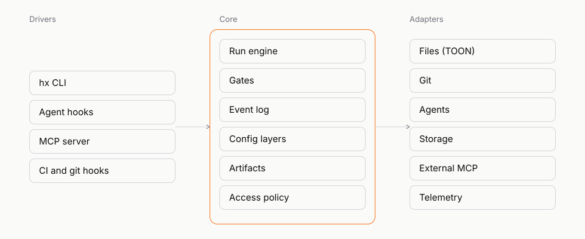

<div align="center">
  <h1><picture>
    <source media="(prefers-color-scheme: dark)" srcset="assets/banner-dark.svg">
    
  </picture></h1>

  <p><strong>Give your coding agent a workflow it can follow, verify and resume.</strong></p>

  <p>
    <a href="https://github.com/mikegorelikoff/unhooked/releases/tag/v0.1.0-preview.1"></a>
    <a href="https://github.com/mikegorelikoff/unhooked/wiki/Skills"></a>
    <a href="LICENSE"></a>
  </p>

  <p>
    <strong><a href="#quick-start">Install hx</a></strong> ·
    <a href="docs/README.md">Documentation</a> ·
    <a href="https://github.com/mikegorelikoff/unhooked/wiki/Workflow-map">Workflow map</a> ·
    <a href="https://github.com/mikegorelikoff/unhooked/wiki/Skills">Skill reference</a>
  </p>
</div>

## What is unhooked?

unhooked is a workflow runner for coding agents. Its command, `hx`, installs skills in a Git project and serves the current step to Claude Code, Codex or another shell-capable agent. A skill defines the work and the checks it needs. The agent performs the work, and `hx done` checks the declared gates before serving the next step.

The run, its questions and its decisions are recorded in the project. You can close the chat, open the same repository later and use `hx resume` to read the current step. The pack includes 40 skills for discovery, planning, specification, design, implementation, review, QA and release.

To see how a gate behaves on a real ticket, skip to [the recorded example](#see-it-in-action).

## Quick start

### 1. Install the CLI

| Platform | Current preview |
| --- | --- |
| macOS on Apple Silicon or Intel | Public binaries and an installer. No GitHub account is required. |
| Linux and Windows | Build from an existing source checkout with Rust 1.96 or newer. Public binaries are pending. |

Run this in your terminal on macOS:

```sh
curl -fsSL https://github.com/mikegorelikoff/unhooked/releases/download/v0.1.0-preview.1/install.sh -o install-unhooked.sh &&
  sh install-unhooked.sh &&
  export PATH="$HOME/.local/bin:$PATH" &&
  hx --version
```

The installer checks the archive's SHA-256 checksum and installs `hx` into `~/.local/bin`. The preview binary prints `hx 0.1.0`. Add the PATH line to your shell profile if you want to start the agent from a new terminal. Set `HX_INSTALL_DIR` before installation to use a different directory, then put that directory on your `PATH` in place of `$HOME/.local/bin`. [Install and agent setup](docs/install-and-agents.md)

### 2. Set up your project

Use an existing Git repository or create an empty one to try the tour:

```sh
mkdir hx-demo
cd hx-demo
git init
hx init --dry-run
hx init
hx doctor
hx start .agents/skills/hx-tour
```

`hx init` asks where to keep specs, which agent to connect, which skill pack to install, how to render documents and whether to export telemetry. Review the changes before applying them. The tour is in both the basic and full packs. Pick the full pack to install all 40 skills.

### 3. Continue in your agent

Open the same repository in the agent you selected, such as Claude Code or Codex. Launch it from an environment where `hx --version` works. In the agent's chat, send:

> Continue the active hx-tour run with hx resume. Read the current step and wait for my input when it asks.

You can run the same commands yourself. `hx status` identifies the active run. `hx resume` shows its current step. `hx done` advances it after the step's checks pass. [Complete the three-step tour](docs/getting-started.md#take-the-tour)

## See it in action

A ticket asks the import API to return the existing job ID when a client retries. In a [worked spec run](docs/getting-started.md#work-a-real-ticket), the `hx-spec` workflow records the requirement and keeps the retry decision open until a stakeholder confirms it. While question `Q-01` is open, the CLI leaves the run at step 2. This is an excerpt from the preview binary:

```text
$ hx done
- no-blocking-questions: no-blocking-questions fails for: Q-01
  failureReason: ids-failing

$ hx artifact answer Q-01 --answer "Return the original job ID" --why "Confirmed with the product owner"
ok: answer Q-01 added to DEMO-42-import-retry

$ hx done
ok: step 2 done
- step 3/4
```

Step 3 checks that the acceptance criterion has a scenario. The final step submits the spec for review. The agent and reviewer can trace the requirement, criterion and scenario by ID.

## What setup changes

| Path in your Git project | Purpose |
| --- | --- |
| `AGENTS.md` | Adds a managed block that explains how the agent should use `hx`. Existing instructions outside the block stay in place. |
| `.agents/skills/hx-*/` | Stores each skill's `SKILL.md`, step files and default settings. |
| `.agents/custom/` | Stores team and personal configuration. Put shared setup in `install.toon`. |
| `.agents/hx/` | Stores local runs, their event logs and the installation record. |
| `.gitignore` | Adds a managed block for runtime and personal files. |
| `.claude/settings.json` | Receives Claude Code hooks when that integration is selected. |

| Agent | How it uses the project |
| --- | --- |
| Claude Code | Reads the shared skills through `.claude/skills/`. Setup configures `PreToolUse` and `Stop`. It links `CLAUDE.md` to `AGENTS.md` when missing. For an existing `CLAUDE.md`, use `hx init --agents claude --claude-md import` to add the managed import. |
| Codex | Reads `AGENTS.md` and `.agents/skills/` directly. Step gates run through `hx done`. |
| Other shell-capable agents | Use the same commands. Expose the skills in a compatible project folder with `hx init --skills-root .tools/skills` if needed. |

Claude Code's write hook checks supported file-write tools when a step declares an allowed path list. It also protects the run directory during active work. Shell commands are outside the write hook's scope. [Hook behavior and existing agent configuration](docs/install-and-agents.md#claude-code)

## Choose a workflow

Start at the point that matches the evidence you already have. A small change can start with a spec. A new product idea can start with discovery. The table assumes the full pack is installed.

| What you have | Start with | Expected result |
| --- | --- | --- |
| An idea or an unclear request | [Discovery and planning](https://github.com/mikegorelikoff/unhooked/wiki/Skills#discovery-and-planning) | An idea card, options with tradeoffs or a ranked backlog. |
| A ticket with an expected behavior | [hx-spec](https://github.com/mikegorelikoff/unhooked/wiki/hx-spec) | A checked spec with requirements, acceptance criteria and scenarios, submitted for review. |
| An approved spec | [hx-implement](https://github.com/mikegorelikoff/unhooked/wiki/hx-implement) | A code change and tests within the approved scope. |
| A finished diff | [hx-quality-gate](https://github.com/mikegorelikoff/unhooked/wiki/hx-quality-gate) and [hx-verify](https://github.com/mikegorelikoff/unhooked/wiki/hx-verify) | Review findings, test results and traceability for required behavior. |
| A change ready to ship | [hx-release](https://github.com/mikegorelikoff/unhooked/wiki/hx-release) | A readiness decision and draft PR bodies. |

Try `hx route "spec this ticket DEMO-42"` to see which installed skill matches a request. A project can also describe a guarded sequence across skills. [Workflow map](https://github.com/mikegorelikoff/unhooked/wiki/Workflow-map) · [Project flows](https://github.com/mikegorelikoff/unhooked/wiki/Project-flows)

## How it works

<picture>
  <source media="(prefers-color-scheme: dark)" srcset="assets/architecture-dark.svg">
  
</picture>

[Open the full-size architecture diagram](assets/architecture-light.svg).

| Layer | Where the work happens |
| --- | --- |
| Drivers | The CLI, agent hooks, MCP server and CI or Git hooks call the same workflow engine. |
| Core | Runs, gates, configuration, records and access checks are handled by the core. |
| Adapters | Git, local TOON files, agent integrations, optional storage, external MCP and telemetry connect the core to the project environment. |

1. **Start a run.** `hx start` loads the installed skill and merges its defaults with team, user and run settings.
2. **Work on the active step.** The agent reads what is required. For example it writes a criterion or gathers verification evidence.
3. **Check the result.** `hx done` evaluates declared gates. These can inspect files and artifacts, run commands or require a current signed approval. A failure reports the check to fix.
4. **Continue or resume.** Run events are recorded in `.agents/hx/`. `hx resume` reads the saved state. The next step can continue in a different chat.

A spec lives in a ticket folder with structured files and rendered Markdown or HTML. A coding agent runs in its own tool. `hx` does not need to send local run state to a service to resume it. Optional storage and metrics integrations follow the project's settings. [Runtime and gates](https://github.com/mikegorelikoff/unhooked/wiki/Runtime-and-gates) · [Configuration](https://github.com/mikegorelikoff/unhooked/wiki/Configuration)

## Documentation and support

| If you want to… | Read |
| --- | --- |
| Install, upgrade or connect an agent | [Install and agents](docs/install-and-agents.md) |
| Finish a tour or try a real gated spec | [Getting started](docs/getting-started.md) |
| Look up a skill's inputs, outputs and checks | [All 40 skills](https://github.com/mikegorelikoff/unhooked/wiki/Skills) |
| Learn where artifacts and evidence live | [Documentation index](docs/README.md) |
| Diagnose an installation or run | [Troubleshooting](https://github.com/mikegorelikoff/unhooked/wiki/Troubleshooting) |

Report reproducible installation or documentation problems in [GitHub Issues](https://github.com/mikegorelikoff/unhooked/issues). Include the operating system, `hx --version` and the failing command.

[Apache 2.0 license](LICENSE) · [Notices](NOTICE)
